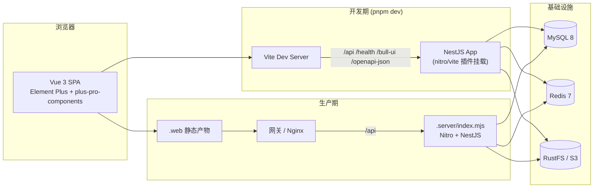

# Nitro Next Template

一套开箱即用的后台管理系统模板：**Vue 3 + NestJS + Nitro** 同仓开发，前后端共享类型与校验规则，构建产物为独立的前端静态资源 + 单文件 Node 服务。

模板内置了完整的 RBAC 权限体系（用户 / 角色 / 岗位 / 部门 / 菜单 / 字典 / 参数配置）、登录安全链路（图形验证码 + RSA 加密密码 + JWT）、系统监控（在线用户 / 登录日志 / 缓存监控）、文件上传与 Excel 导入导出，可直接作为中后台项目的起点。

---

## 技术栈

### 前端

| 领域 | 选型 |
| --- | --- |
| 框架 | Vue 3（`<script setup>` + Composition API）、Vue Router 5、Pinia 4（持久化插件） |
| UI | Element Plus、PlusProComponents（`plus-page` / `plus-form` / `plus-dialog` 驱动 CRUD） |
| 请求 | Alova 3 + `alova/fetch`，接口类型由 OpenAPI 自动生成 |
| 图标 | Iconify（`@iconify-json/ep`） |
| 工具 | VueUse、es-toolkit、dayjs、ufo、zod |
| 构建 | Vite 8 + Rolldown、EJS 模板注入、View Transition、暗色主题 |

### 服务端

| 领域 | 选型 |
| --- | --- |
| 框架 | NestJS 12（Express 之上的 `@nestjs/platform-node`） |
| 运行时 / 构建 | Nitro 3 + Rolldown（服务端打包为 `index.mjs`） |
| ORM | MikroORM 7（`defineEntity` schema 风格）、MySQL 8 |
| 数据校验 | Zod 4 + `StandardSchemaValidationPipe`，`zod-openapi` 生成 OpenAPI |
| 鉴权 | `@xlt-token/*`（JWT HS256 多 kid 轮换、Redis 会话、注解式权限校验） |
| 缓存 / 队列 | Redis 7（ioredis）、BullMQ 6 + Bull Board |
| 文件存储 | `@nestjs/storage` S3 兼容磁盘（本地用 RustFS，可换 MinIO / OSS / S3） |
| 日志 | pino + pino-http + pino-pretty，CLS 串联请求 ID |
| 其他 | nestjs-cls（请求上下文）、nestjs-pino、Terminus 健康检查、excelts、hash-wasm、@napi-rs/canvas |

### 工程化

pnpm + Node 24、TypeScript 6、ESLint（`@antfu/eslint-config`）、Stylelint、Alova Wormhole（接口代码生成）、Docker Compose（MySQL / Redis / RustFS）。

---

## 整体架构



### 分层说明

- **`web/`** — 纯前端 SPA。路由由后端返回的菜单树动态生成，登录态与按钮权限存 Pinia。
- **`server/`** — NestJS 应用，按「控制器 → 服务 → ORM」组织，统一挂在 `/api` 前缀下。
- **`shared/`** — 前后端共享层：枚举（`enum-plus`）、Zod DTO、工具函数。前端默认只引 `enums` / `utils`；`dtos` 通过 `~db` 引用实体类型（`import type`，运行时被擦除），而 `~db` 别名只在 `tsconfig.node.json` 中声明，所以该目录的类型检查由 node 项目负责，`tsconfig.app.json` 里做了 exclude（注意 exclude 只过滤 include 匹配，不阻止显式 import；登录页就单独引了 `loginReqSchema`）。导入导出表不在这一层，见 `server/apis/**/*.excel.ts`。
- **`db/`** — MikroORM 实体（`defineEntity`）与 Seeder，供服务端和 `scripts/*` 共用。
- **`nestjs-modules/`** — 自研可复用模块：`cache`、`captcha`、`excel`、`hash`、`alova`，通过 `registerAsync` 注入配置，全局注册。
- **`scripts/`** — 开发脚本：带环境的 dev 启动、密钥生成、数据库初始化与种子数据。

### 一次请求的完整链路

以「查询用户分页」为例：

1. 页面 `web/views/biz/system/user/index.vue` 调用 `Apis.SystemUser.findPage()`。
2. Alova 拦截器注入 `Authorization: Bearer <token>`，丢弃空查询参数。
3. 请求命中 `/api/system/user/findPage`，`XltTokenGuard` 校验 token 并把当前用户写入 CLS，再校验 `@XltCheckPermission` 声明的按钮权限。
4. `StandardSchemaValidationPipe` 用 Zod schema 校验入参，失败抛 `BadRequestException`（取第一条错误信息）。
5. Service 通过 MikroORM 查询，`ContextService` 提供当前用户与审计字段填充。
6. `DefaultFilter` 统一异常结构，前端 Alova `responded` 拦截器统一弹错，401 时清空登录态。

---

## 目录结构

```
.
├── web/                        # 前端 SPA
│   ├── apis/                   # Alova 生成代码 + 实例配置（勿手改生成文件）
│   ├── components/             # 全局组件（AppTabs / DarkToggle / 验证码 / 改密 / 个人中心）
│   ├── directives/             # v-permission 按钮级权限指令
│   ├── hooks/                  # useDict / usePageInstance / useIcons 等
│   ├── layouts/                # DefaultLayout（侧边栏 + 标签页 + 顶栏）
│   ├── router/                 # 静态路由 + 登录守卫 + 动态路由注入
│   ├── store/                  # Pinia（token / 用户 / 菜单 / 权限）
│   ├── utils/                  # 菜单转路由、RSA 加密、字典、表单、下载
│   └── views/
│       ├── biz/system/         # 用户 / 角色 / 岗位 / 部门 / 菜单 / 字典 / 配置
│       ├── biz/monitor/        # 在线用户 / 登录日志 / 缓存监控
│       └── sys/                # 登录 / 错误页 / redirect
├── server/                     # NestJS 服务端
│   ├── apis/                   # 业务接口（Controller + Service + Module）
│   ├── configs/                # 配置聚合 + 各模块 options
│   ├── constants/enums/        # 错误码、缓存键、CLS 键、URL
│   ├── context/                # 基于 CLS 的请求上下文服务
│   ├── customs/                # ORM 日志、健康检查指标、Redis/Token 定制
│   ├── filters/                # 全局异常过滤器
│   ├── guards/                 # XltTokenGuard（登录 + 权限 + 角色）
│   ├── interceptors/           # 登录日志拦截器
│   ├── middlewares/            # Basic Auth（保护 /health、/bull-ui）
│   ├── queues/                 # BullMQ 队列注册与登录日志消费者
│   ├── remote/                 # 外部服务调用（IP 归属地解析）
│   ├── validators/             # 上传文件类型校验
│   ├── app.module.ts           # 根模块（全局模块 / 守卫 / 管道 / 过滤器）
│   └── main.ts                 # 启动入口、Swagger、Basic Auth
├── shared/                     # 前后端共享：enums / dtos / utils
├── db/                         # entities / seeders
├── nestjs-modules/             # 自研 NestJS 模块（cache/captcha/excel/hash/alova）
├── scripts/                    # dev / gen-secrets / db-init / db-seed
├── resource/                   # 部署资源（.env.deploy、package.json、secrets/）
├── public/                     # 静态资源
├── docker-compose.yml          # MySQL / Redis / RustFS
├── nitro.config.ts             # 服务端构建与部署文件复制
├── vite.config.ts              # 前端构建与 dev 期 nitro 挂载
└── alova.config.ts             # OpenAPI → 前端接口代码生成
```

---

## 核心机制

### 1. 前后端一体开发，构建期分离

- **开发**：`pnpm dev` 启动 Vite，`nitro()` 插件把 NestJS 挂到同一端口；`nitro.config.ts` 的 `$development.routes` 将 `/api|/health|/bull-ui|/openapi-json/**` 交给 `server/main.ts`，其余走 Vite。因此开发期无跨域、无反向代理。
- **生产**：`build:web` 输出 `.web/`（`noPublicDir` 关闭，前端独立部署）；`build:server` 用 Nitro 打包出 `.server/index.mjs`，并把 `resource/.env.deploy`、`resource/package.json`、`resource/secrets/`、`@bull-board/ui` 一并复制进产物目录，产物可脱离源码独立运行。

### 2. Zod 单一数据源：校验 → 文档 → 前端类型

一份 schema 同时产出三样东西：

```
shared/dtos/*.ts (zod)
   ├─> 运行时校验：@Body({ schema: xxxSchema() }) + StandardSchemaValidationPipe
   ├─> OpenAPI 文档：zod-openapi 转换（input/output 双向，响应剥离 additionalProperties）
   └─> 前端接口类型：alova wormhole 读取 /openapi-json 生成 web/apis/
```

`lazySchema()` 延迟构造避免循环依赖，`defineSchema` 负责注册组件名。实体对应的 schema 放在 `shared/dtos/for-db`，用 `satisfies EntityDtoSchema<Entity>` 保证字段与实体一致；接口出入参放在 `shared/dtos/for-api`。

### 3. 登录与鉴权

```
GET  /api/auth/public-key   → 返回 RSA 公钥（SPKI/Base64）
POST /api/auth/login        → { userName, password(密文), captchaId, captchaValue }
                              ↓ 验证码校验（Redis）→ RSA-OAEP-256 解密 → bcrypt 校验
                              ↓ StpLogic.login() 签发 JWT（HS256，多 kid，7d）
后续请求                     → Authorization: Bearer <token>
                              ↓ XltTokenGuard 校验 + 写入 CLS + @XltCheckPermission 权限校验
```

- 密码在浏览器用 `crypto.subtle` 加密，明文不出网；RSA 密钥对由 `pnpm gen:secrets` 生成到 `resource/secrets/`。
- 生产环境缺少密钥文件会**直接启动失败**，避免多实例各自生成导致解密随机失败。
- 权限标识统一维护在 `shared/enums/permission.ts`，服务端 `@XltCheckPermission(PermissionEnum.X)` 与前端 `v-permission="PermissionEnum.X"` 同源。
- 用户权限来自「角色 → 菜单」聚合：菜单类型为 `F`（按钮）的 `menuKey` 作为权限点，其余作为路由。

### 4. 请求上下文（CLS）

`nestjs-cls` 为每个请求建立独立上下文，`ContextService` 封装常用能力：

- `getCurrentUser()` / `setCurrentUser()`
- `bindCurrentUserToEntity(entity, 'create' | 'update')` 自动填充审计字段
- `createHttpContext()` 适配 xlt-token 的 `HttpContext`
- 开发环境自动生成请求 ID，pino 日志统一携带

### 5. 异步任务与监控

- 登录成功/失败由 `LoginLogInterceptor` 投入 `login_log` 队列，不阻塞登录响应。
- `LoginLogProcessor` 消费任务：解析 IP 归属地（内网 IP 直接标记），写入 `sys_login_log`；失败重试 3 次、指数退避。
- Bull Board 面板挂载在 `/bull-ui`，开发环境用 Basic Auth 保护（默认 `admin / 123456`）。
- 健康检查 `/health` 覆盖 MySQL、磁盘水位、堆内存、外部 IP 解析服务。

### 6. 文件存储

上传走 S3 兼容磁盘（本地 RustFS）：

- 单文件上限 20 MB，按**文件头**识别类型（图片 / PDF / ZIP 容器），不信任客户端声明。
- 对象键为 `{visibility}/{biz}/{uuid}{ext}`，可见性决定是否匿名可读。
- 公开文件直接返回公开地址；私有文件校验归属后签发 300 秒临时地址。
- 数据库写入失败会回收已落盘对象，避免孤儿文件。

### 7. 表格与导出

`nestjs-modules/excel` 基于 excelts + Zod：`defineExcel({ fileName, schema })` 即定义一张表的结构，导出按 schema 流式写出，导入按 schema 列顺序读取原始值交给业务校验。用户模块提供了完整的导入模板 / 导入 / 导出示例。

---

## 功能清单

| 模块 | 能力 |
| --- | --- |
| 登录鉴权 | 图形验证码、RSA 加密登录、登出、公钥下发 |
| 个人中心 | 查看/修改个人资料、修改密码、头像上传 |
| 用户管理 | 分页查询、新增、编辑、删除、导出、导入模板、批量导入 |
| 角色管理 | 分页、增删改、导出、分配用户、分配菜单 |
| 岗位管理 | 分页、增删改、导出、分配用户 |
| 部门管理 | 树形列表、增删改 |
| 菜单管理 | 树形列表、增删改（目录 / 菜单 / 按钮，控制路由与权限） |
| 字典管理 | 字典类型与字典数据两级维护、按类型查询、导出 |
| 参数配置 | 分页、增删改、按键查询、导出 |
| 在线用户 | 在线会话分页、强制下线 |
| 登录日志 | 登录记录分页（IP、归属地、UA、耗时、状态） |
| 缓存监控 | 键列表分页、按 key 查看详情、删除、清空 |
| 文件存储 | 上传、公开/私有访问、私有文件签名地址 |
| 系统运维 | 健康检查、队列面板 |

---

## 快速开始

### 环境要求

- Node.js **24**（见 `.node-version`）
- pnpm
- Docker（用于本地 MySQL / Redis / RustFS）

### 启动步骤

```bash
# 1. 安装依赖
pnpm install

# 2. 启动基础设施（MySQL 3306 / Redis 6379 / RustFS 9000、9001）
docker compose up -d

# 3. 生成登录加密与 JWT 密钥（写入 resource/secrets/）
pnpm gen:secrets

# 4. 建表 + 灌入种子数据
pnpm db:init
pnpm db:seed

# 5. 启动开发环境（前端 + API 同端口）
pnpm dev
```

默认账号：`admin / 123456`（初始密码来自 `db/seeders/sys-config.seeder.ts` 的 `sys.user.initPassword`）。

开发地址：

| 地址 | 说明 |
| --- | --- |
| `http://localhost:5173` | 前端页面 |
| `http://localhost:5173/api/*` | 业务接口 |
| `http://localhost:5173/openapi` | Swagger UI（仅 dev） |
| `http://localhost:5173/openapi-json` | OpenAPI JSON（接口生成源） |
| `http://localhost:5173/bull-ui` | 队列面板（Basic Auth） |
| `http://localhost:5173/health` | 健康检查 |
| `http://localhost:9001` | RustFS 控制台 |

### 常用脚本

| 命令 | 作用 |
| --- | --- |
| `pnpm dev` | 以 `APP_ENV=dev` 启动 Vite + Nest |
| `pnpm build:web` | 构建前端到 `.web/` |
| `pnpm build:server` | 构建服务端到 `.server/` |
| `pnpm gen:apis` | 从 OpenAPI 生成前端接口代码到 `web/apis/` |
| `pnpm gen:secrets` | 生成 RSA 密钥对与 JWT keys（已存在则跳过） |
| `pnpm db:init` | 重建数据库结构（`dropDb`，会清数据） |
| `pnpm db:seed` | 写入种子数据 |

> `gen:apis` 读取 `alova.config.ts` 中的 `http://localhost:3000/openapi-json`。若本地端口不同，先改这个地址或按实际端口启动服务。

---

## 构建与部署

```bash
pnpm build:web      # → .web/
pnpm build:server   # → .server/
```

`.server/` 内容：

```
.server/
├── index.mjs        # Nitro 打包后的服务入口
├── _chunks/ _libs/  # 拆分的代码与追踪到的依赖
├── node_modules/    # traceDeps 追踪出的运行时依赖
├── secrets/         # 由 resource/secrets/ 复制而来
├── .env.deploy      # 部署环境变量
└── package.json     # start: node --env-file .env.deploy index.mjs
```

启动方式：

```bash
cd .server && node --env-file .env.deploy index.mjs
```

部署要点：

1. `.web/` 是纯静态资源，交给 Nginx / CDN 托管；`.server/` 只提供 `/api`、`/health`、`/bull-ui`，需由网关把 `/api` 转发到 Node 服务（同域部署最省事，前端 Alova `baseURL` 为空）。
2. **密钥必须随产物分发**：`resource/secrets/` 会在构建时整体复制到 `.server/secrets/`，不要提交到公开仓库，也不要让多实例各自生成。
3. 生产配置来自 `resource/.env.deploy`（`APP_ENV=prod`、`NITRO_PORT` 等），`ConfigModule` 显式忽略 `.env` 文件，因此不要在 `.env` 里期待服务端配置生效。
4. 换存储只需改 `S3_*` 环境变量（endpoint / bucket / 凭证 / publicUrl），代码无需改动。

### 环境变量

| 变量 | 说明 |
| --- | --- |
| `APP_ENV` | `dev` / `prod`，决定配置分支与是否输出 Swagger |
| `NITRO_PORT` | 服务监听端口（默认 3000） |
| `NITRO_SHUTDOWN_DISABLED` | 部署环境关闭 Nitro 自带优雅退出钩子 |
| `AUTH_RSA_PUBLIC_KEY` / `AUTH_RSA_PRIVATE_KEY` | 可选，PEM **文件路径**；不配则读 `resource/secrets/`（prod 为 `secrets/`） |
| `S3_ENDPOINT` / `S3_BUCKET` / `S3_REGION` | S3 兼容存储地址与桶 |
| `S3_ACCESS_KEY` / `S3_SECRET_KEY` | 存储凭证 |
| `S3_PUBLIC_URL` | 公开读地址（建议指向 CDN 或反向代理） |
| `VITE_APP_TITLE` | 前端页面标题（`.env`，构建期注入） |

---

## 开发约定

### 新增一个接口

1. 在 `shared/dtos/for-api/` 定义请求/响应 schema（`lazySchema` + `defineSchema`），导出对应类型。
2. 在 `server/apis/<模块>/` 写 Controller / Service / Module，Controller 用 `@Body({ schema })`、`@Query({ schema })` 接入校验，用 `@XltCheckPermission(PermissionEnum.X)` 声明权限。
3. 在 `shared/enums/permission.ts` 增加权限点，并同步到菜单种子数据（按钮类型菜单）。
4. 需要导入导出时，在业务模块目录建 `<模块>.excel.ts`（如 `server/apis/system/user/user.excel.ts`），用 `defineExcel` 声明表格，由 Controller 直接相对引用；这类表格定义不进 `shared/dtos`，避免 API 契约混入表格实现。
5. 模块注册到 `server/apis/apis.module.ts` 的 `imports` 与 `RouterModule` 路由树（`/api` 前缀在此统一挂载）。
6. 启动服务后执行 `pnpm gen:apis`，前端即可获得 `Apis.Xxx.yyy()` 的类型提示。

### 新增一个页面

1. 在 `web/views/biz/<模块>/index.vue` 建页面（`import.meta.glob` 按 `views/biz/<component>/index.vue` 约定自动加载）。
2. 按现有模式拆分 `hooks/`：`useCreate`、`useUpdate`、`useRemove`、`useExport`、`useImport`，页面只负责列定义与编排。
3. 在「菜单管理」新增菜单记录，`component` 填相对 `views/biz/` 的路径，`menuKey` 决定权限标识；按钮权限用 `v-permission` 控制显隐。
4. 路由无需手写：登录后 `useUserStore.getInfo()` 拉取菜单树，`web/utils/menu.ts` 转成路由并 `addRoute`。

### 其他约定

- 数据库主键统一 UUID v7（`BaseEntity.id`），审计字段 `createBy/createdAt/updateBy/updatedAt` 由实体钩子与 `ContextService` 填充。
- 软删除使用 `isDelete` 枚举字段，查询需显式带上条件。
- 枚举统一用 `enum-plus` 定义，同时导出 `XxxEnum`、`XxxEnumValues`、`XxxEnumMap`。
- 配置按环境用 `ts-pattern` 的 `match(APP_ENV)` 分支声明，避免散落的 `process.env` 判断。
- 生成文件（`web/apis/createApis.ts`、`apiDefinitions.ts`、`globals.d.ts`）不要手改，改 schema 后重新生成。
- `web/**` 禁止 import `~db`、`~server`、`~nestjs-modules` 及服务端运行时库（`@mikro-orm/*`、`@nestjs/*`、`bullmq` 等）：dev 下 nitro 插件会注入这些别名，代码能解析，但 `build:web` 只有 `~web` / `~shared`，打包必失败。该边界由 ESLint 的 `ts/no-restricted-imports` 强制。
- 提交前跑 ESLint：`npx eslint .`。
